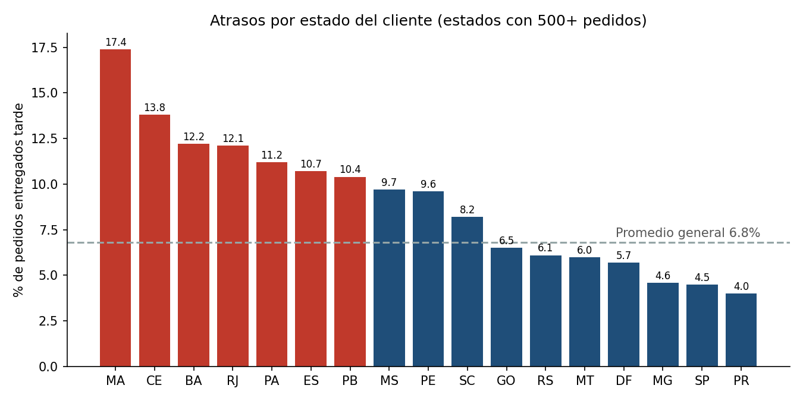
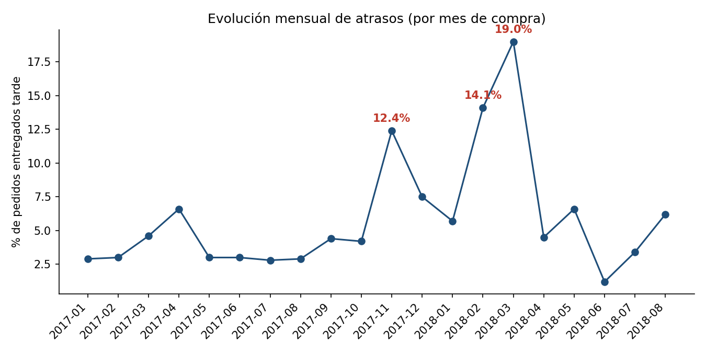
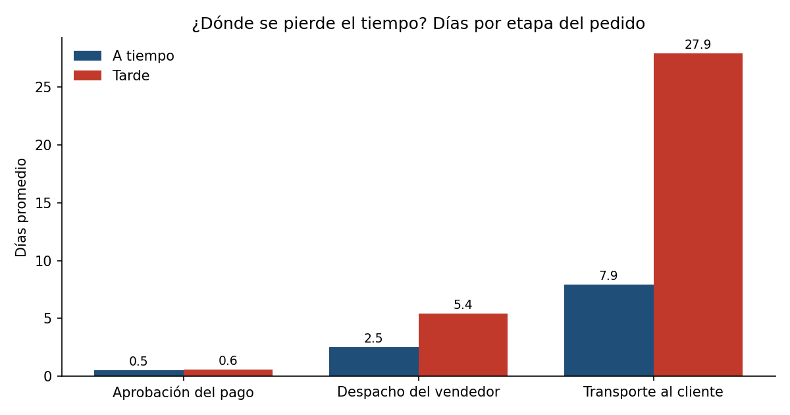
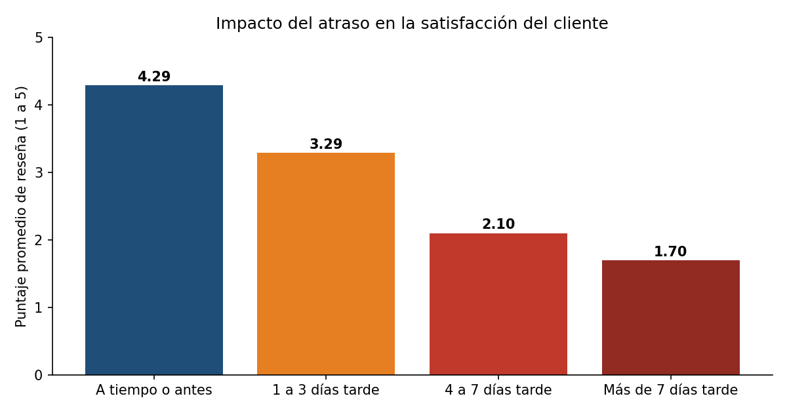

# Análisis de entregas de e-commerce: planificado vs. ejecutado

Análisis con **SQL (MySQL)** y **Excel** de casi 100.000 pedidos reales de un e-commerce, para medir cuántos pedidos llegan tarde, dónde y por qué, y cuánto impacta el atraso en la satisfacción del cliente.

La idea central es comparar lo **planificado** (la fecha de entrega prometida al cliente) con lo **ejecutado** (la fecha real de entrega), detectar los desvíos y proponer mejoras.

## Datos

[Brazilian E-Commerce Public Dataset by Olist](https://www.kaggle.com/datasets/olistbr/brazilian-ecommerce) (Kaggle). Pedidos reales de un marketplace brasileño entre 2016 y 2018, con fechas de compra, despacho, entrega real y entrega estimada, ubicación de clientes y vendedores, y reseñas.

Se analizaron **96.470 pedidos entregados**.

## Preguntas de negocio

1. ¿Qué porcentaje de pedidos llega tarde y por cuántos días?
2. ¿En qué zonas se concentran los atrasos?
3. ¿Cómo evolucionan los atrasos mes a mes?
4. ¿En qué etapa del pedido se pierde el tiempo?
5. ¿Los vendedores que despachan tarde generan entregas tarde?
6. ¿Influye que vendedor y cliente estén en distinto estado?
7. ¿Cuánto afecta el atraso a la satisfacción del cliente?
8. ¿La fecha prometida al cliente está bien calibrada?

## Hallazgos principales

**1. El 6,8 % de los pedidos llega tarde, y cuando llega tarde, se atrasa 10,6 días en promedio.**

**2. La fecha prometida es muy conservadora.** Se promete entregar en 24,4 días, pero en promedio se entrega en 12,5. El 74 % de los pedidos llega más de una semana antes de lo prometido. Una promesa más ajustada podría mejorar la conversión de ventas sin aumentar los atrasos.

**3. Los atrasos se concentran en algunas zonas.** Maranhão (17,4 %), Ceará (13,8 %), Bahía (12,2 %) y Río de Janeiro (12,1 %) casi triplican a São Paulo (4,5 %). Río de Janeiro es el caso más relevante por volumen: más de 12.000 pedidos con 12 % de atraso.



**4. Los picos de demanda disparan los atrasos.** En noviembre de 2017 (Black Friday) el atraso subió al 12,4 %, y en febrero y marzo de 2018 llegó al 14,1 % y al 19 %. La capacidad logística no acompañó el aumento de volumen.



**5. El cuello de botella es el transporte.** En los pedidos que llegan tarde, el transporte tarda 27,9 días contra 7,9 en los que llegan a tiempo. El despacho del vendedor también se duplica (5,4 contra 2,5 días). La aprobación del pago no influye.



**6. Cuando el vendedor despacha tarde, el riesgo de atraso se multiplica por casi 4:** 20,8 % de entregas tarde contra 5,4 % cuando despacha a tiempo.

**7. Las rutas entre distintos estados se atrasan casi el doble** que las rutas dentro del mismo estado (8,0 % contra 4,5 %).

**8. El atraso destruye la satisfacción del cliente.** El puntaje promedio cae de 4,29 (a tiempo) a 1,70 (más de 7 días tarde), y las reseñas negativas pasan del 9 % al 79 %.



## Recomendaciones

- **Alertas tempranas sobre vendedores:** detectar los pedidos despachados después de la fecha límite y darles prioridad en el transporte, porque tienen 4 veces más riesgo de llegar tarde.
- **Planificar capacidad para los picos:** reforzar la capacidad de transporte antes de Black Friday y de los meses de alta demanda.
- **Promesas de entrega por zona:** acortar la fecha prometida donde se entrega mucho antes (por ejemplo, São Paulo) y ser más realista en las zonas con más atrasos.
- **Foco en Río de Janeiro:** es la zona con más pedidos atrasados en números absolutos, así que mejorarla es lo que más impacto tiene.
- **Comunicación proactiva:** avisar al cliente cuando se detecta un atraso, para reducir el impacto en las reseñas.

## Estructura del proyecto

```
├── sql/
│   ├── 01_crear_tablas.sql     # Creación de la base y las tablas
│   ├── 02_cargar_datos.sql     # Carga de los CSV
│   └── 03_analisis.sql         # Vista base y las 8 consultas de análisis
├── resultados/                 # Resultado de cada consulta en CSV
├── graficos/                   # Gráficos del análisis
├── analisis_entregas.xlsx      # Resultados en Excel con fórmulas y gráficos
└── data/                       # Acá van los CSV del dataset (no incluidos)
```

## Cómo reproducirlo

1. Descargar el dataset de Kaggle y copiar los CSV en la carpeta `data/`.
2. Desde la carpeta del proyecto, ejecutar:
   ```
   mysql -u root -p < sql/01_crear_tablas.sql
   mysql --local-infile=1 -u root -p < sql/02_cargar_datos.sql
   mysql -u root -p < sql/03_analisis.sql
   ```

## Herramientas

MySQL / MariaDB · SQL (JOINs, CTEs, funciones de ventana, agregaciones) · Excel · Claude (IA) como asistente para el desarrollo y la documentación.

## Autor

Gabriel Esteban Birman · Analista Programador (Instituto Tecnológico ORT)
